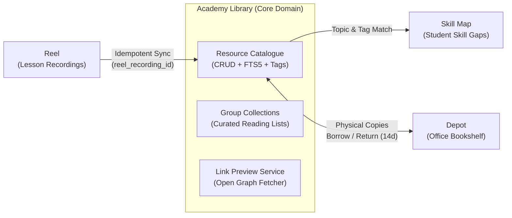
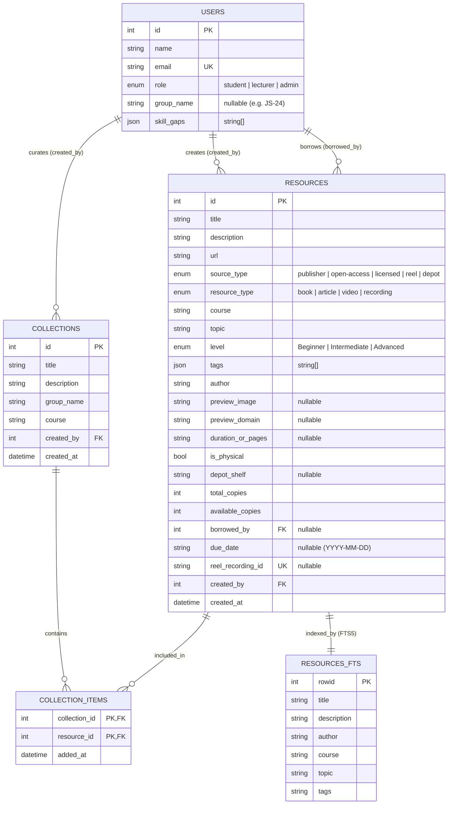

# Domain Model — Picsart Academy Library

Այս փաստաթուղթը նկարագրում է **Picsart Academy Library** համակարգի դոմենային մոդելը՝ էությունները (Entities), կապերը (Relationships), սահմանափակումները (Domain Invariants) և արտաքին համակարգերի հետ սահմանները (Bounded Contexts)։

---

## 1. Bounded Contexts (Համակարգի Սահմանները)

---

## 2. Entity-Relationship Diagram (ER Դիագրամ)

---

## 3. Հիմնական Էություններ և Value Objects

### 3.1 `User`
- **Identity:** `id`, եզակի `email`։
- **Role (Value Object):** `student | lecturer | admin`։
- **Cohort Context:** `group_name` (օր.՝ `JS-24`, `PY-24`) և `skill_gaps` (թեմաների ցուցակ, որը գալիս է Skill Map-ից)։

### 3.2 `Resource` (Aggregate Root)
Գրադարանի կենտրոնական էությունն է։ Միավորում է.
- **Մետադատա.** `title`, `description`, `author`, `course`, `topic`, `level`, `tags[]`, `resource_type`։
- **Արտաքին օրինական աղբյուր.** `url`, `source_type`, `preview_domain`, `preview_image`։
- **Depot (ֆիզիկական գրքի վիճակ).** `is_physical`, `depot_shelf`, `total_copies`, `available_copies`, `borrowed_by`, `due_date`։
- **Reel կապ.** `reel_recording_id` (եզակի ID՝ ավտոմատ ներմուծման կրկնությունները բացառելու համար)։

### 3.3 `Collection` + `CollectionItem`
- Խմբային հավաքածու (`Collection`) և նյութերի միջև **Many-to-Many** կապ (`CollectionItem`)։
- Մեկ նյութը կարող է ընդգրկվել մի քանի խմբերի հավաքածուներում՝ առանց նյութը կրկնօրինակելու։

---

## 4. Բիզնես Կանոններ (Domain Invariants)

1. **Միայն օրինական աղբյուրներ.** `url`-ը պարտադիր պետք է սկսվի `http://` կամ `https://`-ով և չի կարող լինել `.torrent` կամ ծովահենային ռեսուրս։
2. **Պահեստային օրինակների ամբողջականություն (Depot).**
   - `0 <= available_copies <= total_copies`։
   - Եթե `is_physical = false`, ապա `total_copies = 0` և գիրքը չի կարող վերցվել (`400 Bad Request`)։
   - Եթե `available_copies === 0`, նոր օգտատերը չի կարող վերցնել (`409 Conflict`)։
   - Նույն օգտատերը չի կարող միաժամանակ վերցնել նույն գրքի երկրորդ օրինակը (`409 Conflict`)։
   - Վերադարձնել կարող է միայն գիրքը վերցրած օգտատերը կամ `Admin`-ը (`403 Forbidden`)։
3. **Դերերի և սեփականության կանոններ (RBAC).**
   - `Student` — միայն ընթերցում (Read) + Depot Borrow/Return։
   - `Lecturer` — Create + Edit/Delete **միայն իր** (`created_by === user.id`) ստեղծած նյութերն ու հավաքածուները + Reel Sync։
   - `Admin` — լիարժեք իրավասություններ բոլոր էությունների վրա։
4. **Reel սինխրոնիզացիայի Idempotency.** նույն `reel_recording_id`-ով ձայնագրությունը երկրորդ անգամ չի ներմուծվում։
5. **Որոնման ինդեքսի համաժամանակեցում.** `resources` աղյուսակում ցանկացած `INSERT / UPDATE / DELETE` անմիջապես թարմացնում է `resources_fts` վիրտուալ աղյուսակը և մաքրում `facets` քեշը։

---

## 5. Իրավասությունների Մատրիցա (Permissions Matrix)

| Գործողություն | Student | Lecturer (իրը) | Lecturer (ուրիշի) | Admin |
|---|:---:|:---:|:---:|:---:|
| Դիտել / Որոնել կատալոգը | ✅ | ✅ | ✅ | ✅ |
| Ավելացնել նյութ / հավաքածու | ❌ | ✅ | ✅ | ✅ |
| Խմբագրել / Ջնջել նյութ կամ հավաքածու | ❌ | ✅ | ❌ | ✅ |
| Սինխրոնիզացնել Reel դասերը | ❌ | ✅ | ✅ | ✅ |
| Վերցնել ֆիզիկական գիրք (Depot) | ✅ | ✅ | ✅ | ✅ |
| Վերադարձնել ուրիշի վերցրած գիրքը | ❌ | ❌ | ❌ | ✅ |
